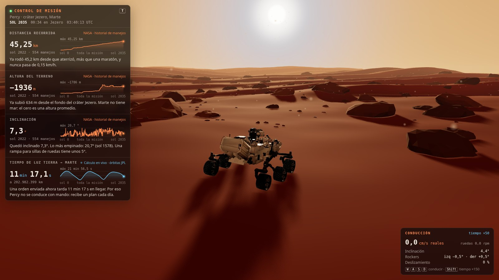
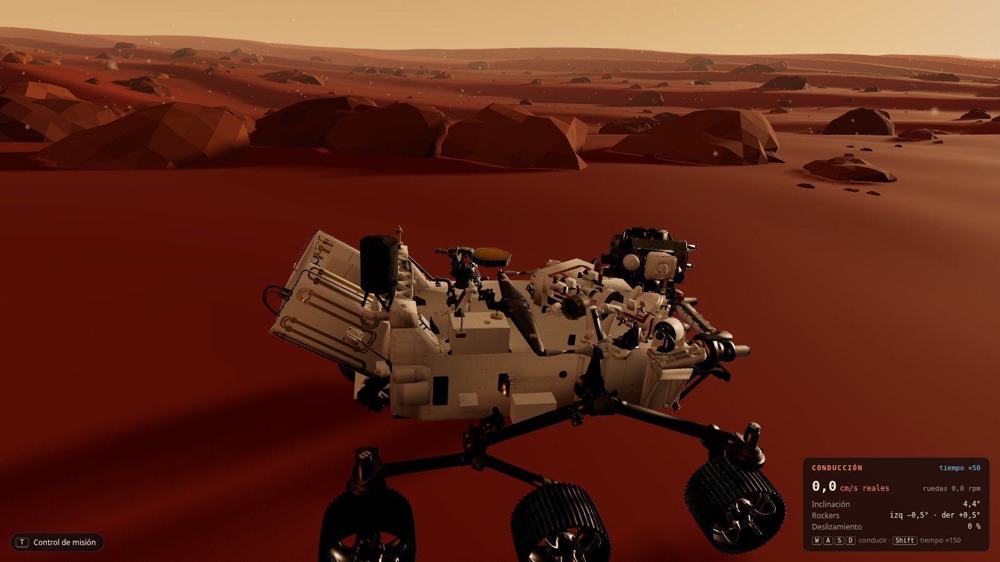
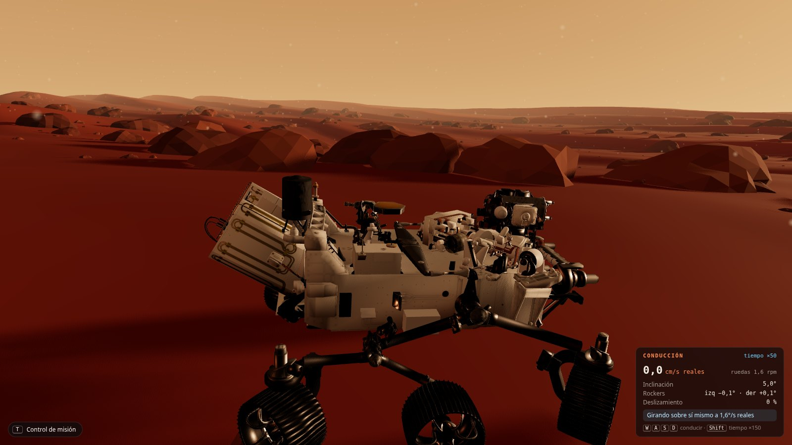
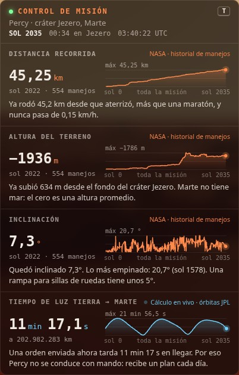

# Perseverancia

An interactive 3D simulation of NASA's **Perseverance** rover ("Percy") exploring Mars, built with [Three.js](https://threejs.org/) and [Vite](https://vite.dev/). You drive the rover across a Martian landscape with the real rover's suspension and steering. A mission control panel shows real telemetry from the actual mission.

> The in-game interface is in Spanish.



## Features

### A drivable Perseverance with real rover physics

- **Real speed.** The rover moves at Perseverance's real top speed of 4.2 cm/s. Game time runs ×50 (×150 with Shift) so the drive stays playable, and the on-screen gauge always shows the time scale.
- **Six spinning wheels.** In NASA's 3D model the wheels and suspension are fused into single meshes. At load time the game splits them into separate moving parts.
- **Rocker-bogie suspension.** Each wheel rests on the ground beneath it. A differential bar keeps the body at the average angle of the left and right rockers, as on the real rover.
- **Real steering.**
  - Only the four corner wheels steer; the middle wheels are fixed.
  - In curves the front and rear wheels turn in opposite directions (double Ackermann).
  - The rover can turn in place.
  - It stops to orient its wheels before it rolls.
- **Terrain interaction.**
  - The rover climbs small rocks and stops at rocks taller than about 40 cm.
  - It also stops at rocks that would hit its belly, and at slopes that would tilt it past 30°.
  - It slips when climbing.

| Rocker-bogie suspension | Turning in place |
|---|---|
|  |  |

### Mission control with real telemetry



The panel follows the telemetry pattern of NASA's [Open MCT](https://github.com/nasa/openmct). Each value has a name, a unit and a provider, and the panel asks a small telemetry hub for history (`request`) and live updates (`subscribe`).

- **Distance driven, terrain elevation and tilt** come from NASA's public drive history of the mission, the Mars 2020 waypoints file. Each comes with a chart of the whole mission.
- **Earth–Mars light time** is calculated live in the browser from JPL's approximate orbital elements. It shows how long a command takes to reach the rover right now.
- Each value has a one-line, plain-language explanation of what it means.
- The header shows the current mission sol and the local time in Jezero crater.
- Press **T** to hide or show the panel.

<br clear="right">

## Run it locally

You need [Node.js](https://nodejs.org/) 22 or newer.

```bash
git clone https://github.com/jhonalex06/perseverance.git
cd perseverance
npm install
npm run dev
```

Then open http://localhost:5173/.

## Controls

| Key | Action |
|---|---|
| `W` / `S` | Drive forward / backward |
| `A` / `D` | Turn left / right. Pressed alone, the rover turns in place |
| `Shift` | Speed up time (×150 instead of ×50) |
| `T` | Hide or show mission control |
| Mouse drag / wheel | Orbit around the rover / zoom |

## Automated check

```bash
npm run check
```

The check opens the game in headless Chrome and saves screenshots to `screenshots/`. It fails if anything below goes wrong:

- The browser console must have no errors.
- The four mission control values must load with plausible numbers.
- The **T** key must hide and show the panel.
- **Driving straight:** all six wheels spin, none is steered, and the speed is 4.2 cm/s.
- **Arcing:** the front and rear wheels steer in opposite directions.
- **Turning in place:** the corner wheels go diagonal and the rover rotates without moving.

The check uses the Chrome installed on your system (`/usr/bin/google-chrome` by default, or set `CHROME_PATH`). NASA's CDN returns 403 to headless Chrome, so during the check Node downloads the waypoints file and hands it to the page. In a normal browser the game fetches it from NASA directly.

## Project structure

```
src/
├── main.js            Scene setup, camera and main loop
├── terrain.js         Procedural dunes
├── rocks.js           Instanced rocks
├── sky.js             Martian sky, sun halo, Phobos and Deimos
├── dust.js            Floating dust particles
├── tracks.js          Wheel tracks left in the sand
├── rover.js           Loads the 3D model and drives it (physics)
├── rig.js             Splits wheels and suspension into moving parts
├── ground.js          What the wheels feel: dunes and rocks
├── driveHud.js        Driving gauge (real speed, tilt, rockers, slip)
└── mission/
    ├── telemetry.js   Mini telemetry hub (Open MCT pattern)
    ├── providers.js   NASA drive history and live light-time providers
    ├── points.js      The four telemetry values: name, unit, format, explanation
    ├── orbits.js      Earth–Mars distance and Mars sol clock
    └── panel.js       Mission control panel and charts
scripts/check.mjs      npm run check
public/models/         Perseverance 3D model (glTF + Draco)
```

## Data and credits

- **3D model:** NASA's Perseverance rover model.
- **Drive history:** NASA/JPL-Caltech, Mars 2020 waypoints from the mission's MMGIS map: `https://mars.nasa.gov/mmgis-maps/M20/Layers/json/M20_waypoints.json`
- **Orbits:** E. M. Standish (JPL), *Keplerian Elements for Approximate Positions of the Major Planets*.
- **Mars time:** the Mars24 algorithm (NASA GISS), with sol 0 on 18 February 2021, the landing day.
- **Telemetry design:** inspired by [NASA Open MCT](https://github.com/nasa/openmct).

This is a fan project. It is not affiliated with or endorsed by NASA.
